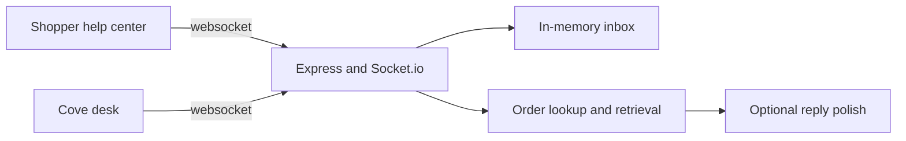

# AI Support Assistant

Cove is a support chatbot for Northline, a fictional outdoor shop. It answers from the shopper's order and a small help catalog. When the question asks for a person, or when the catalog does not cover it, Cove queues the same thread for a human desk.

The desk has no login. That is intentional for a portfolio demo. Say so if you show it: a production desk authenticates agents before they can claim a chat.

## Show this in two minutes

1. Install and start the app. You need Node.js 20 or newer.

   ```bash
   npm install
   npm run dev
   ```

2. Open the shopper at [http://localhost:5173](http://localhost:5173). Stay as Avery Chen. The order card shows the Trailhead Parka, `NL-10482`, out for delivery.
3. Ask `Where is order NL-10482?` Cove answers from that order, not from a generic paragraph.
4. Switch to Jordan Hale and ask `Can I return the Ridgeline Boots?` The reply uses the 12-day delivery and the 30-day return note.
5. Switch to Sam Okonkwo and ask `Why was I charged twice?` The reply names the duplicate Trail Club charge.
6. Click **Talk to a person**.
7. Open the desk at [http://localhost:5173/desk](http://localhost:5173/desk). Claim the chat, reply, and resolve it.
8. Return to the shopper. The reply is already in the thread, then the rating row appears.

Use two windows side by side. The handoff is live over a websocket, so the shopper sees the agent join without refreshing.

## What Cove will and will not answer

Policy lives in code. A model, if you add a key, only rewrites a reply that the policy already accepted.

| Shopper says | Cove does |
| --- | --- |
| Asks for a human, person, or representative | Queues the desk and keeps the transcript |
| Asks where their order is, or names their order id | Reads that shopper's order |
| Asks to return or exchange their own item | Leads with that order, then quotes the return note |
| Asks how a general policy works | Quotes the best help note when enough of the question matches |
| Asks something the notes do not cover | Refuses to guess and queues the desk |

The desk shows the handoff reason, a tone flag (`Needs care` when the wording is frustrated), the help note Cove used, and internal notes. Notes never go out on the shopper socket.

## Architecture



The browser and the server share Zod schemas in `shared/`. Each socket payload is parsed before the UI renders it. Shopper snapshots use a schema that has no `notes` field. The server also strips notes before it emits that snapshot.

Restarting the server clears the inbox. Transcripts stay in the process. There is nothing to migrate and nothing written to disk.

## Run locally

```bash
npm install
npm test
npm run dev
```

| Script | What it does |
| --- | --- |
| `npm run dev` | API on port 4000 and the web app on port 5173 |
| `npm test` | Retrieval, inbox rules, and a live handoff over websockets |
| `npm run typecheck` | Typechecks the server and the web app |
| `npm run build` | Builds the static web app into `web/dist` |
| `npm start` | Serves the API and, after a build, the static web app on port 4000 |

Copy `.env.example` to `.env` only if you want to change the port or turn on model polish.

### Optional model polish

```bash
OPENAI_API_KEY=sk-...
OPENAI_MODEL=gpt-4o-mini
```

With a key, Cove rewrites the grounded draft. It does not get to invent policy. If the call fails or times out, the shopper still gets the original draft. Without a key, the draft is the reply. The badge in the header says which mode is on.

## Layout

```text
shared/     Zod contracts and socket event names
server/     Inbox, retrieval, responder, HTTP, Socket.io
web/        Shopper help center and the agent desk
```

The three demo shoppers and the help notes live in `server/src/personas.ts` and `server/src/knowledge-base.ts`.

## Honest limits

- The desk is open. Do not put real customer data in it.
- The inbox is memory. A restart ends every chat.
- Retrieval is lexical. It is there to show the handoff boundary, not to replace a search stack.
- Tone is a short word list, not a classifier.
- Northline, the orders, and the charges are fiction.
